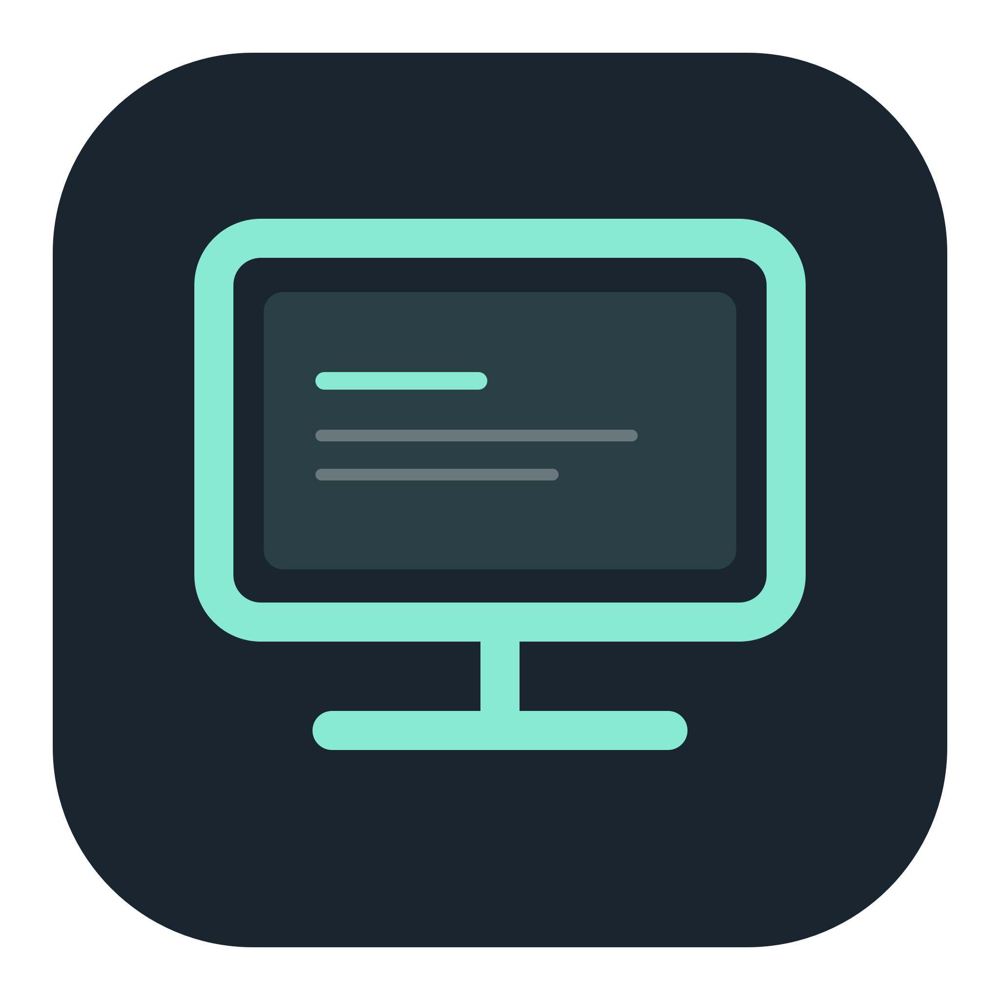
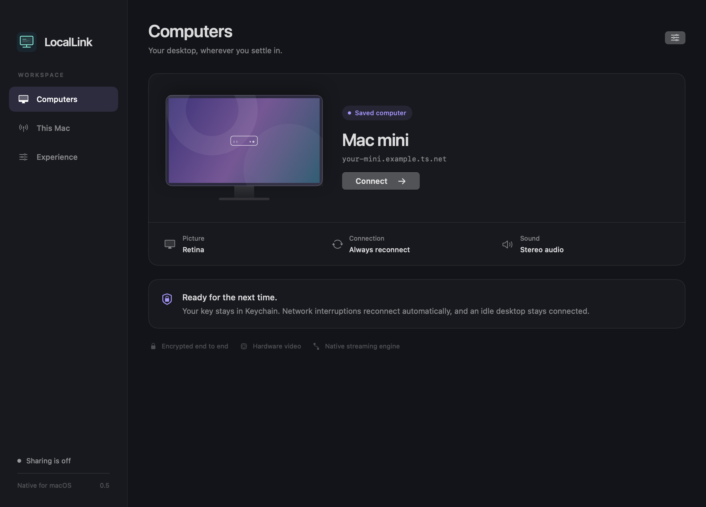

<p align="center"></p>

# LocalLink

A native remote desktop app for your own Macs. **LocalLink handles capture, video encoding and decoding, system sound, and mouse and keyboard control itself.** No Parsec, Sunshine, Moonlight, browser runtime, or streaming server application is required. Tailscale provides the private connection between your Macs.

**[Download the native engine preview](https://github.com/random-guy-05/LocalLink/releases/tag/v0.5.2)** · macOS 14+ · Intel and Apple Silicon



Version 0.5 improves the working native engine with a redesigned workspace, native full screen, higher-quality profiles, and persistent connections. A two-Mac stream was confirmed by the user on 0.4.1. The new fullscreen and host changes still need a live two-Mac check; synthetic tests cannot establish internet latency or smoothness.

## Install on both Macs

1. Download `LocalLink-0.5.2-universal.dmg`, open it, and drag LocalLink to Applications on **both** Macs.
2. Keep [Tailscale](https://tailscale.com/download/mac) connected on both Macs.
3. On the host Mac, open LocalLink → **This Mac**. Give **LocalLink** Screen Recording (screen and system audio) and Accessibility permissions. Restart LocalLink after granting Screen Recording.
4. Click **Start sharing this Mac**, then **Copy key**. Keep the host awake, signed in, and LocalLink running. LocalLink prevents idle system sleep while sharing; it does not bypass the lock screen, FileVault login, or a closed laptop lid.
5. On the viewing Mac, enter the host’s Tailscale IP or hostname and paste its pairing key. Click **Connect to Mac**.
6. Click the picture in the remote desktop window for input. Click the green macOS window button for native full screen (red closes, yellow minimizes); Command–Shift–D disconnects. Control–Command–F toggles native full screen; Control–Option–Command–Escape releases or recaptures input. Move to the top edge for the floating controls. Fit, Fill and Actual Pixels scaling are available there. Closing the viewer disconnects it. Network drops keep the viewer window and its full-screen Space open and retry automatically. Manual disconnect cancels retries, preserves your key and offers Reconnect. Stop sharing on the host to make it unavailable.

There is no Sunshine dashboard, Moonlight pairing, SSH password, or additional host service. Permissions previously given to another app do not apply to LocalLink.

This preview is ad-hoc signed and **not Apple-notarized**. If macOS blocks the downloaded app, use [Apple’s Privacy & Security → Open Anyway process](https://support.apple.com/102445). Developer ID signing and notarization remain future release work.

## Native engine

| Component | Implementation |
| --- | --- |
| Screen and system sound | Apple ScreenCaptureKit |
| H.264 / HEVC encode and decode | Apple VideoToolbox, hardware required |
| Video presentation | AVSampleBufferDisplayLayer, with a bounded latest decoded surface |
| Stereo audio | 48 kHz float PCM through AVAudioEngine; no audio driver installation |
| Mouse and keyboard | CoreGraphics events, gated by Accessibility |
| Secure transport | Apple Network.framework, TLS 1.2 PSK AES-128-GCM over TCP |
| Internet reachability | Your existing Tailscale connection; port 48100 |
| Pairing secrets | 256-bit system randomness, stored in macOS Keychain |
| Interface | SwiftUI and AppKit |

Each TLS connection authenticates the pairing key. TLS session resumption and tickets are disabled so old authenticated sessions cannot bypass a changed key. The TLS PSK identity is bound to the key. No self-signed certificate bypass, plaintext fallback, telemetry, hosted account, or public signaling service is used. This PSK suite does not provide forward secrecy by itself; Tailscale supplies an additional encrypted network layer.

The host accepts one streaming viewer at a time, caps pending handshakes, validates protocol version and stream bounds, bounds packets before allocation, releases pressed keys on disconnection/focus loss, and stops capture when the viewer leaves. Fit shows the whole desktop; Fill and Actual Pixels can crop it when its proportions or pixel dimensions exceed the viewer. Treat the pairing key as remote-control access: anyone with it can connect while sharing is on. **New pairing key** revokes the old key. The host listener can bind to interfaces beyond Tailscale; restrict port 48100 with your firewall if required. Do not forward it publicly.

## Picture and performance

- **Retina (default):** up to 3840 × 2160, 60 fps, 70 Mbps.
- **Studio:** up to 5120 × 3200, 60 fps, 120 Mbps. Requires the updated host and compatible hardware; 5K operation has not been verified on every Mac.
- **Balanced:** up to 2560 × 1600, 60 fps, 35 Mbps.
- **Travel:** up to 1920 × 1080, 60 fps, 12 Mbps.
- ScreenCaptureKit uses its best capture resolution and real display pixel scale. Source dimensions are preserved when smaller than the selected ceiling: no upscaling. Hardware encoding requests quality-oriented hints without enabling frame reordering or software fallback.
- HEVC is the default. Switch it off for hardware H.264 compatibility. Higher resolutions may exceed an older Mac’s hardware limits.
- Host display proportions are preserved. These are requested upper bounds, not guaranteed delivered frame rates or resolutions. No virtual display is created.
- The host skips raw capture frames before encoding when transmission is busy; the viewer can replace decoded surfaces awaiting presentation. Compressed inter-frame references are not discarded.
- The toolbar measures decoded surfaces passed to the renderer, encoded video throughput and connection round trips. The FPS count is not a display scanout measurement; RTT is not click-to-photon latency. Audio bandwidth is additional (about 3.1 Mbps of uncompressed stereo).

Current limits: one display (the first capture display), one viewer, SDR 8-bit 4:2:0, no clipboard/file transfer, no HDR/4:4:4, and no multi-monitor selector. TCP can stall on packet loss; adaptive bitrate and a datagram transport remain future work. Audio uses a small bounded buffer without adaptive A/V clock synchronization. The app cannot promise a near-native experience on every internet connection.

## Build and verify

Requires Apple Command Line Tools on macOS 14+. No third-party runtime, package manager or dependency download is needed to build the app.

```sh
bash build.sh
LOCALLINK_ARCHS="x86_64 arm64" bash build.sh
bash test.sh
```

`dist/LocalLink.app` is the universal app. Tests check encrypted loopback traffic, wrong-key rejection, binary and stream bounds, and synthetic hardware H.264/HEVC video round trips through 4K. A native viewer integration test checks repeated reconnects with one key, automatic recovery after an interrupted socket, manual disconnect cancelling retries, static desktop heartbeats, and display fitting. Synthetic tests never capture the screen or inject input. GitHub CI compiles both architectures and runs the transport tests; its virtual machine skips hardware codec tests. Neither replaces a two-Mac session test.

To package the optional styled DMG (packaging-only Python dependency):

```sh
python3 -m venv .venv
.venv/bin/python -m pip install -r requirements-release.txt
DMGBUILD=.venv/bin/dmgbuild bash release.sh
```

The release includes a SHA-256 checksum. Personal addresses, pairing keys and local settings are never bundled.

## Standard window controls in 0.5.2

Both the workspace and remote desktop have a standard macOS title bar. The green traffic light enters and exits native full screen instead of expanding the window. Red closes; yellow minimizes. Control–Command–F and the viewer toolbar also toggle full screen. This viewer-only change works with the existing 0.5.1 host; the host does not need an update.

## Permission recovery in 0.5.1

Legacy `CGPreflightScreenCaptureAccess` results are advisory and never block starting the host listener. The real ScreenCaptureKit capture operation enforces screen authorization; **This Mac → Test screen access** checks ScreenCaptureKit directly. Successful verification survives a false legacy preflight. Accessibility is checked independently: unavailable Accessibility allows an explicitly labelled view-only stream, while input injection continues to require macOS trust. Its status updates on an active viewer when the host’s trust changes.

A real capture denial is delivered to the viewer before the host closes its channel. Terminal permission errors stop retries and display the actual failure and recovery steps; they are not converted into an indefinite reconnection spinner.

These builds are ad-hoc signed. An update changes the signing identity macOS uses for privacy authorization, so System Settings can still display an allowed entry for an older build. If the actual capture test reports denial on the mini: quit LocalLink, remove its old entry from **Screen & System Audio Recording**, add the current `/Applications/LocalLink.app` and enable it; do the same in **Accessibility**, then reopen LocalLink and start sharing. Use the installed app shown in the permission panel’s Running path. Existing keys remain unchanged. Developer ID signing remains unresolved; this patch does not grant or bypass OS permissions.

Tests exercise a real encrypted host listener with injected false advisory flags and separately verify delivery of a terminal host permission error to the native viewer. They do not assert that macOS authorized screen capture on the user’s mini.

## Persistence and key reuse

Connection health uses authenticated ping/pong responses, not changing video frames. A static desktop stays connected. Network failures retry at 1, 2, 4, 8, then at most 15 seconds while **Reconnect automatically** is on. Explicit disconnect cancels the retry and does not rotate credentials.

The viewer sends a goodbye message and waits briefly for the host’s acknowledgement. The host releases the session and serializes screen-capture teardown before accepting the next stream. Pending close work retains its channel until it completes. Only **New key** replaces the host key; Keychain access failures never trigger automatic key replacement.

The last active viewer session and sharing state restore when LocalLink reopens. **Experience → Open at login** uses Apple ServiceManagement; enable it separately on the mini and viewer if wanted. macOS may ask you to approve Login Items. This does not bypass login, FileVault, sleep, a powered-off computer, or Tailscale access. Stop sharing clears the saved sharing intent. Closing the workspace keeps menu-bar hosting running; closing the remote desktop explicitly disconnects it. Quit preserves the last active intent for the next app launch.

Update **both Macs** for the complete feature set and new host cleanup. The standard Retina request remains within 0.4’s request bounds; Studio needs 0.5. Your existing key is reused. If macOS requests Keychain access after an ad-hoc app update, allow the new LocalLink to read its existing saved item.

## Source

`Native/Transport.swift` defines the secure channel and bounded protocol. `Video.swift` captures, encodes and decodes video. `Audio.swift` carries native stereo sound. `Control.swift` renders surfaces and handles input. `Model.swift` owns sessions, host lifecycle, permissions and Keychain. `App.swift`, `Home.swift`, `Viewer.swift`, and `ViewerWindow.swift` contain the native workspace and full-screen viewer. `Experience.swift` defines quality, geometry and connection-health policies. Earlier streaming integrations remain available in Git history at tag `v0.3.0`.
