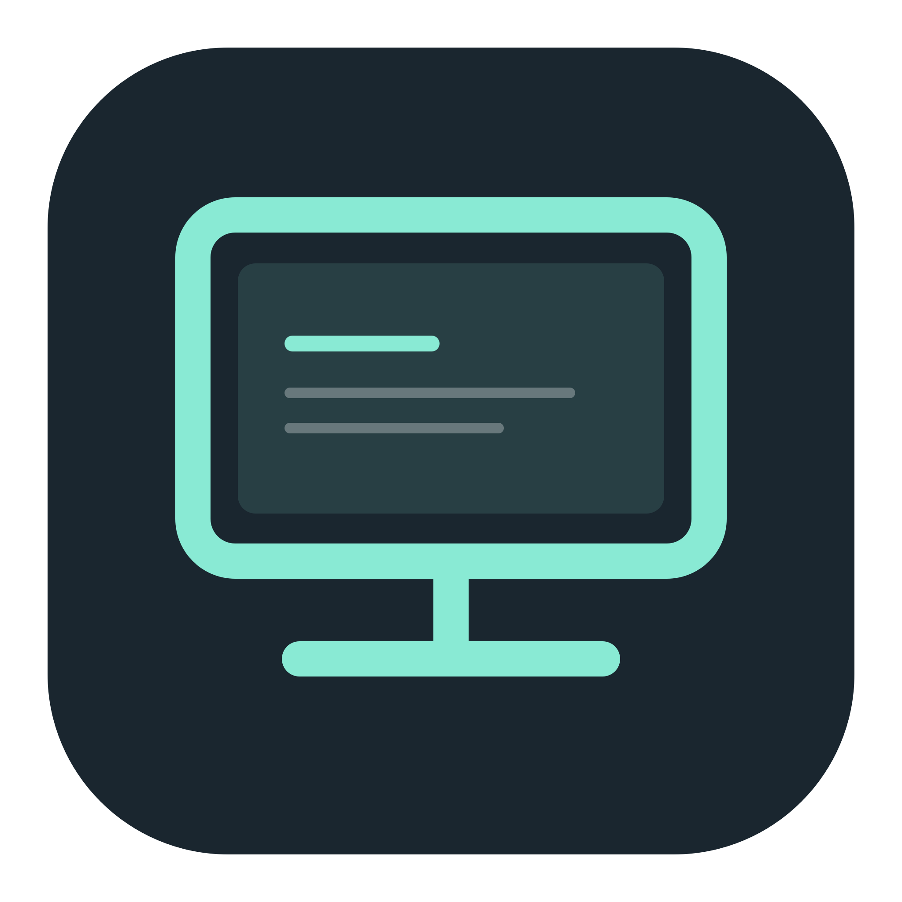
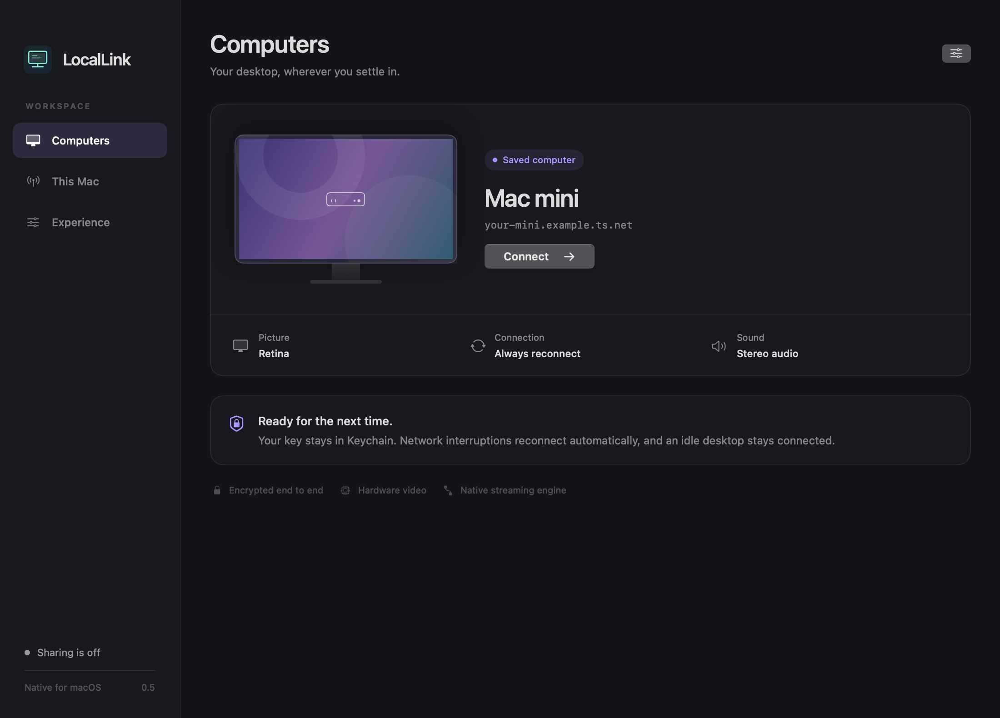

<p align="center"></p>

# LocalLink

A native remote desktop app for your own Macs. LocalLink does its own screen capture, hardware video encoding and decoding, system audio, and mouse and keyboard control. It needs no Parsec, Sunshine, Moonlight, browser or streaming server. Tailscale provides the private connection between the two Macs.

**[Download v0.5.3](https://github.com/random-guy-05/LocalLink/releases/tag/v0.5.3)** · Intel and Apple Silicon



## Download

| DMG | macOS |
|---|---|
| [LocalLink-0.5.3-universal.dmg](https://github.com/random-guy-05/LocalLink/releases/download/v0.5.3/LocalLink-0.5.3-universal.dmg) | 14 Sonoma or later |
| [LocalLink-0.5.3-legacy-macos12.3-universal.dmg](https://github.com/random-guy-05/LocalLink/releases/download/v0.5.3/LocalLink-0.5.3-legacy-macos12.3-universal.dmg) | 12.3 Monterey and 13 Ventura |

Pick the right DMG for each Mac separately; a Legacy viewer can connect to a Standard host. macOS 11 and earlier are not supported.

The Legacy build keeps hardware H.264/HEVC, remote control, full screen, saved keys and reconnects. On a Monterey host, system audio capture is unavailable (it needs macOS 13), and launch at login must be set manually in System Preferences → Users & Groups → Login Items. A Monterey or Ventura two-Mac session has not been tested yet.

Builds are ad-hoc signed and not notarized. If macOS blocks the app, use [Privacy & Security → Open Anyway](https://support.apple.com/102445).

## Setup

1. Install LocalLink in Applications on both Macs and keep [Tailscale](https://tailscale.com/download/mac) connected on both.
2. On the host, open **This Mac** and grant LocalLink Screen Recording and Accessibility. Restart LocalLink after granting Screen Recording.
3. Click **Start sharing this Mac**, then **Copy key**. Keep the host awake, signed in and running LocalLink.
4. On the viewer, enter the host's Tailscale IP or hostname, paste the key and click **Connect to Mac**.

### Controls

| Action | Shortcut |
|---|---|
| Toggle full screen | Green window button or Control–Command–F |
| Release or recapture input | Control–Option–Command–Escape |
| Disconnect | Command–Shift–D, or close the viewer |
| Scaling (Fit, Fill, Actual Pixels) | Toolbar at the top edge |

Dropped connections retry automatically (1, 2, 4, 8, then every 15 seconds). A manual disconnect cancels retries and keeps your key. While sharing, LocalLink prevents idle sleep; it can't get past the lock screen, FileVault or a closed lid.

## How it works

| Component | Implementation |
|---|---|
| Screen and system audio capture | ScreenCaptureKit |
| H.264 / HEVC | VideoToolbox (hardware only) |
| Video display | AVSampleBufferDisplayLayer |
| Audio | 48 kHz stereo PCM through AVAudioEngine |
| Input | CoreGraphics events, gated by Accessibility |
| Transport | Network.framework, TLS 1.2 PSK with AES-128-GCM over TCP, port 48100 |
| Pairing key | 256-bit random, stored in the Keychain |
| Interface | SwiftUI and AppKit |

### Quality profiles

| Profile | Maximum | Bitrate |
|---|---|---|
| Retina (default) | 3840 × 2160, 60 fps | 70 Mbps |
| Studio | 5120 × 3200, 60 fps | 120 Mbps |
| Balanced | 2560 × 1600, 60 fps | 35 Mbps |
| Travel | 1920 × 1080, 60 fps | 12 Mbps |

These are upper bounds: LocalLink never upscales and keeps the host's aspect ratio. HEVC is on by default; turn it off for H.264 on older hardware. Audio adds about 3.1 Mbps. The toolbar's FPS counts decoded frames, and its RTT is network round trip, not click-to-photon latency.

### Security

Every connection authenticates with the pairing key, and TLS session resumption is disabled, so generating a new key immediately locks out old sessions. There's no plaintext fallback, telemetry, account or relay server. The PSK suite has no forward secrecy on its own; Tailscale adds a second encrypted layer.

The host accepts one viewer at a time, bounds handshakes and packet sizes, and releases held keys when a viewer disconnects. Anyone with the key can connect while sharing is on, so treat it like a password. The listener can bind beyond the Tailscale interface: firewall port 48100 if needed and never forward it publicly.

### Limitations

One display, one viewer, SDR 8-bit 4:2:0. No clipboard, file transfer, HDR or monitor picker. TCP can stall on packet loss; there's no adaptive bitrate or A/V clock sync yet.

## Build

Requires Xcode (Command Line Tools alone lack the SwiftUI macro plugin). No third-party dependencies.

```sh
bash scripts/build.sh                                              # Standard, this Mac's architecture
LOCALLINK_ARCHS="x86_64 arm64" bash scripts/build.sh               # Standard, universal
LOCALLINK_VARIANT=legacy LOCALLINK_ARCHS="x86_64 arm64" bash scripts/build.sh
bash scripts/test.sh                                               # add LOCALLINK_VARIANT=legacy for Legacy
dist/legacy/LocalLink.app/Contents/MacOS/LocalLink --legacy-ui-smoke-test
```

Output goes to `dist/LocalLink.app` (Standard) and `dist/legacy/LocalLink.app` (Legacy). Tests cover encrypted loopback traffic, wrong-key rejection, protocol bounds, synthetic H.264/HEVC round trips up to 4K, and reconnect behavior. None of them capture the screen or inject input. CI builds both variants for both architectures and skips hardware codec tests.

To package a DMG:

```sh
python3 -m venv .venv
.venv/bin/python -m pip install -r requirements-release.txt
DMGBUILD=.venv/bin/dmgbuild bash scripts/release.sh               # add LOCALLINK_VARIANT=legacy for Legacy
```

## Source layout

| Path | Contents |
|---|---|
| `Sources/Transport.swift` | Secure channel and protocol |
| `Sources/Video.swift`, `Audio.swift` | Capture, encode and decode |
| `Sources/Control.swift` | Rendering and input |
| `Sources/Model.swift`, `Permissions.swift` | Sessions, host lifecycle, permissions, Keychain |
| `Sources/Experience.swift` | Quality, geometry and connection-health policy |
| `Sources/App.swift`, `Home.swift`, `Viewer*.swift`, `Window*.swift` | Interface |
| `Sources/LegacyApplication.swift` | AppKit shell for macOS 12.3–13 |
| `Tests/` | Transport, video and session tests |
| `Tools/` | Icon and DMG artwork generators, DMG settings |
| `scripts/` | Build, test and release scripts |

See [CHANGELOG.md](CHANGELOG.md) for release notes. Earlier integrations with Moonlight and Sunshine are in Git history at tag `v0.3.0`.
